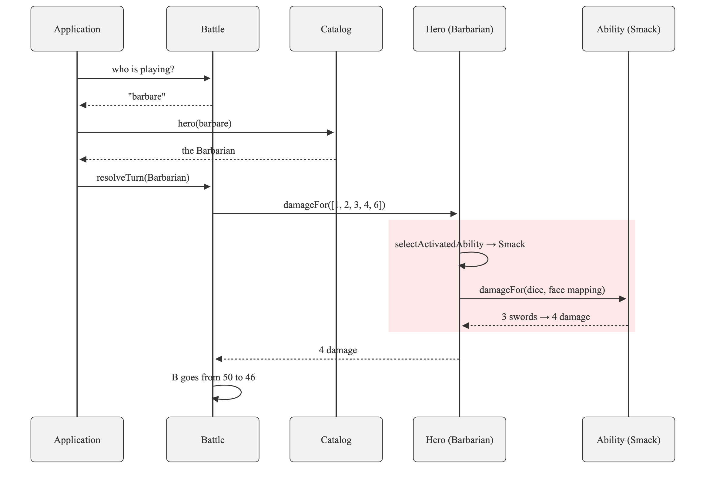

**Agojie** automates **Dice Throne**, a turn-based fighting board game played with dice. In the previous episode, the first two slices had set up a game skeleton and a dice-rolling machine. Turns alternated, the dice rolled, and nobody could attack yet.

This episode covers the next three slices, written between July 14 and July 18. By the end of them, a game can be played end to end: the dice point to an ability, the ability deals its damage, the defender heals. The last of the three also moved a rule of the model. Neither a test nor a review revealed it. A hero sheet did.

## The Dice Point to an Ability

Each hero has their own dice, and each face carries a symbol. Their offensive abilities trigger on a combination of those symbols. Take the result [1, 2, 3, 4, 6]. For the Barbarian, faces 1, 2 and 3 carry a sword: three swords, and <u>Smack</u> is activated. For the Pyromancer, the same faces carry a flame, and <u>Fireball</u> is the one that triggers. Same roll, two heroes, two abilities.

This scenario checks that the selection reads the hero’s data, and that no rule specific to the Barbarian is hard-coded in the engine. Here is the hero:


namespace App\Combat\Domain\Hero;

final readonly class Hero
{
    private function __construct(
        private FaceMapping $faceMapping,
        private array $abilities,
    ) {}

    public static function of(FaceMapping $faceMapping, array $abilities): self
    {
        return new self($faceMapping, $abilities);
    }

    public function selectActivatedAbility(DiceOutcome $outcome): ?Ability
    {
        foreach ($this->abilities as $ability) {
            if ($ability->matches($outcome, $this->faceMapping)) {
                return $ability;
            }
        }

        return null;
    }
}


Nothing in this class says “Barbarian.” The hero receives the table that maps each face to its symbol, then the list of its abilities, and walks through that list. The Barbarian and the Pyromancer are two objects of this same class, built with different data. They live in an in-memory catalog, behind the ***HeroCatalog*** **Port**. Here is the Barbarian as that catalog declares it:


namespace App\Combat\Infrastructure\Hero;

final class InMemoryHeroCatalog implements HeroCatalog
{
    // …

    private function barbarian(): Hero
    {
        return Hero::of(
            FaceMapping::fromPairs([
                1 => 'épée', 2 => 'épée', 3 => 'épée',
                4 => 'cœur', 5 => 'cœur',
                6 => 'boum',
            ]),
            [Ability::of('Frappe', SymbolCount::of(3, 'épée'))],
        );
    }
}


The face mapping says which symbol each face of the die carries. The ability gives its name and its combination: at least three swords. The Pyromancer is declared the same way, with flames instead of swords and <u>Fireball</u> instead of <u>Smack</u>. Adding a hero means writing a method like this one, without touching the engine.

What’s left to show is how an ability recognizes its combination. The hero asks through ***matches***, and the ability passes the question on to its combination:


namespace App\Combat\Domain\Hero;

final readonly class Ability
{
    private function __construct(
        private string $name,
        private SymbolCount $combination,
    ) {}

    public static function of(string $name, SymbolCount $combination): self
    {
        return new self($name, $combination);
    }

    public function name(): string
    {
        return $this->name;
    }

    public function matches(DiceOutcome $outcome, FaceMapping $mapping): bool
    {
        return $this->combination->isSatisfiedBy($outcome, $mapping);
    }
}



namespace App\Combat\Domain\Hero;

final readonly class SymbolCount
{
    // …

    public function isSatisfiedBy(DiceOutcome $outcome, FaceMapping $mapping): bool
    {
        return $mapping->countOf($this->symbol, $outcome) >= $this->required;
    }
}


On [1, 2, 3, 4, 6], the Barbarian’s face mapping counts the dice that carry a sword: faces 1, 2 and 3, so three. <u>Smack</u>’s combination requires at least three. 3 ≥ 3: the ability answers, and the hero returns it. The “at least” of ***>=*** is what makes a five-sword roll activate <u>Smack</u> as well.

On the application side, this read goes through a **Query**. It is the read side of CQRS described by *Greg Young*: a message that reads state without changing anything, the counterpart of the **Command**. The message only carries the game’s identifier. All the work happens in the object that handles it:


namespace App\Combat\Application\FindActivatedAbility;

#[AsMessageHandler(bus: 'query.bus', method: 'handle')]
final readonly class FindActivatedAbilityQueryHandler
{
    public function __construct(
        private BattleRepository $repository,
        private HeroCatalog $catalog,
    ) {}

    public function handle(FindActivatedAbilityQuery $query): ?ActivatedAbilityView
    {
        $battle = $this->repository->find(BattleId::fromString($query->battleId));
        $activeHeroId = $battle->heroIdOf($battle->activeSide());
        $hero = $this->catalog->hero($activeHeroId);
        $ability = $hero->selectActivatedAbility($battle->offensiveOutcome());

        if (null === $ability) {
            return null;
        }

        return new ActivatedAbilityView($ability->name());
    }
}


Let’s follow it through our example. A plays the Barbarian and has just rolled [1, 2, 3, 4, 6]. The game is loaded. It doesn’t contain the Barbarian, only its identifier: asked “who is playing?” it answers “barbare.” The catalog receives that identifier and returns the matching hero:


namespace App\Combat\Infrastructure\Hero;

final class InMemoryHeroCatalog implements HeroCatalog
{
    // …

    public function hero(HeroId $id): Hero
    {
        return match ($id->value) {
            'barbare' => $this->barbarian(),
            'pyromancienne' => $this->pyromancer(),
            default => throw new \RuntimeException(sprintf('Unknown hero "%s".', $id->value)),
        };
    }
}


The hero then receives the dice result, kept by the game, and checks it against its abilities. Three swords: it returns <u>Smack</u>, and the **Query** answers with its name. Had A rolled [4, 4, 5, 5, 6], no ability would have answered, and the **Query** would have returned nothing.

This **Query** was first called ***SelectActivatedAbilityQuery***. The same day, the review had it renamed to ***FindActivatedAbilityQuery***. The return type, ***?ActivatedAbilityView***, gives the reason: the answer can be empty, and the project’s convention reserves the ***Find*** prefix for reads that may return nothing. The hero keeps ***selectActivatedAbility***, the name of the move in the game.

This is the mechanism decided by the ADR from the previous episode, shown in code for the first time. The game refers to the hero by its identifier, the application fetches its definition from the catalog, and the hero applies its own rule.

## The Attack Finally Lands

The next slice applies the damage of the activated ability. The acceptance criteria reuse the same roll:

- B is at 50 health points. A rolls [1, 2, 3, 4, 6], three swords, and <u>Smack</u> is activated. B drops to 46.
- B is at 50. A rolls [1, 2, 3, 1, 2], five swords. B drops to 42.
- B is at 4. A activates <u>Smack</u> for 4 damage. B drops to zero, the game ends, A wins.

Here is the path of a turn in the first example, before getting into the code. The colored area is what the game never sees:

Damage depends on the number of symbols rolled. In the catalog, <u>Smack</u>’s declaration gains its damage table:


namespace App\Combat\Infrastructure\Hero;

final class InMemoryHeroCatalog implements HeroCatalog
{
    // …

    private function barbarian(): Hero
    {
        return Hero::of(
            FaceMapping::fromPairs([
                1 => 'épée', 2 => 'épée', 3 => 'épée',
                4 => 'cœur', 5 => 'cœur',
                6 => 'boum',
            ]),
            [Ability::of('Frappe', SymbolCount::of(3, 'épée'), [3 => 4, 4 => 6, 5 => 8])],
        );
    }
}


Three swords deal 4 damage, four deal 6, five deal 8. ***Ability*** receives this table in a third field, ***damageByCount***, and gets the method that reads it:


namespace App\Combat\Domain\Hero;

final readonly class Ability
{
    // …

    public function damageFor(DiceOutcome $outcome, FaceMapping $mapping): Damage
    {
        $symbolsRolled = $this->combination->countIn($outcome, $mapping);

        if (!isset($this->damageByCount[$symbolsRolled])) {
            throw new \LogicException(sprintf('Ability "%s" deals no damage for %d symbols.', $this->name, $symbolsRolled));
        }

        return Damage::fromValue($this->damageByCount[$symbolsRolled]);
    }
}


Back to [1, 2, 3, 4, 6]. The ability counts its swords in the result, using the Barbarian’s face mapping: faces 1, 2 and 3 carry one, faces 4 and 6 don’t. Three swords. For three symbols, the damage table returns 4: <u>Smack</u> deals 4 damage, and B drops from 50 to 46. With [1, 2, 3, 1, 2], the count rises to five, the table returns 8, and B drops to 42.

Before coding a slice, I write its technical plan: the path an action follows through the code, object by object. The code is then written in the small cycles of *Kent Beck*’s **Test-Driven Development**: a failing test, the code that makes it pass, then a cleanup. Here, the technical plan had the game chain the two steps itself. It was supposed to ask the hero for its activated ability, then ask that ability for its damage. On the third cycle, that path didn’t hold. To count its symbols, the ability needs the hero’s face mapping. The game would therefore have had to fetch that mapping from the hero and pass it along. The game’s state would have started handling catalog data, exactly what the ADR set out to avoid.

So the hero composes the two steps itself:


namespace App\Combat\Domain\Hero;

final readonly class Hero
{
    // …

    public function damageFor(DiceOutcome $outcome): ?Damage
    {
        $activated = $this->selectActivatedAbility($outcome);

        if (null === $activated) {
            return null;
        }

        return $activated->damageFor($outcome, $this->faceMapping);
    }
}


The game only receives the result: damage, or nothing. Here is how it resolves the turn:


namespace App\Combat\Domain\Battle;

final class Battle
{
    // …

    public function resolveTurn(Hero $activeHero): void
    {
        if ($this->isOver()) {
            throw BattleAlreadyOverException::cannotResolveTurn();
        }

        $damage = $activeHero->damageFor($this->offensiveOutcome());
        $this->offensiveRoll = null;

        $defendingSide = $this->opponentOf($this->activeSide);

        if (null !== $damage) {
            $this->strike($defendingSide, $damage);
        }

        if ($this->isOver()) {
            return;
        }

        $this->activeSide = $defendingSide;
    }

    private function strike(Side $defendingSide, Damage $damage): void
    {
        $defender = $this->combatantOf($defendingSide);
        $defender->takeDamage($damage);

        if ($defender->isDefeated()) {
            $this->winner = $this->activeSide;
        }
    }
}


The application loads the active hero from the catalog, as in the **Query** above, and passes it to the game. The game gives the hero the dice result and gets 4 damage back. It applies the damage to B, then hands over the turn. If B is at 4, B drops to zero, and A is declared the winner. Nowhere does the game see an ability, a face mapping or a damage table. The deviation from the plan was recorded in the technical plan, below the initial version, rather than erased. The corrected plan and the ADR now say the same thing.

## A Hero Sheet Moves a Rule

The third slice brings defense. When the attack activates an ability, the defender rolls their defensive ability and heals. For the Barbarian, it is <u>Thick Skin</u>, which heals 2 health points per heart rolled. B is at 50. A deals 6 damage, <u>Thick Skin</u> heals 2. B ends at 46.

One piece of information was still missing before this slice could be written. The document describing the heroes marked defensive rolls as provisional, to be confirmed on the physical hero sheet: how many health points per symbol, and how many dice. The slice was declared ready all the same. On July 17, I read the sheets. <u>Thick Skin</u> rolls three dice. <u>Magma Armor</u>, the Pyromancer’s defense, rolls five.

Three on one side, five on the other. The number of dice is therefore a piece of data belonging to the ability, not a constant of the game. Yet a rule of the model had been saying the opposite since the dice-rolling machine.

That rule is an **Invariant**. *Eric Evans* uses the term for a consistency rule that must remain true whenever the data changes. This one said that a dice result has exactly five faces, and it lived in ***DiceOutcome***, the object that represents the result of a roll:


namespace App\Combat\Domain\Battle;

final readonly class DiceOutcome
{
    private const int FACE_COUNT = 5;

    public static function fromValues(array $values): self
    {
        if (self::FACE_COUNT !== count($values)) {
            throw new \InvalidArgumentException(sprintf(
                'A dice outcome must have exactly %d faces, got %d.',
                self::FACE_COUNT,
                count($values),
            ));
        }

        return new self(array_map(Face::fromValue(...), $values));
    }
}


As long as the only roll in the game was the offensive one, nothing was wrong. But ***DiceOutcome*** doesn’t represent an offensive roll; it represents a dice result. The rule was attached to the wrong concept. In the specification, it already belonged to the offensive phase: five dice, free rerolls, at most three rolls. With this rule in place, the Barbarian couldn’t defend. His <u>Thick Skin</u> roll gives three faces, for example [4, 4, 5]. ***DiceOutcome::fromValues([4, 4, 5])*** counts three values instead of five, and throws “A dice outcome must have exactly 5 faces, got 3.”

So the rule moved. ***DiceOutcome*** now accepts any number of dice, and only rejects an empty result:


namespace App\Combat\Domain\Battle;

final readonly class DiceOutcome
{
    // …

    public static function fromValues(array $values): self
    {
        if ([] === $values) {
            throw new \InvalidArgumentException('A dice outcome must have at least one face.');
        }

        return new self(array_map(Face::fromValue(...), $values));
    }
}


The five moves to ***OffensiveRoll***, the object that carries the offensive phase and its three rolls:


namespace App\Combat\Domain\Battle;

final readonly class OffensiveRoll
{
    public const int DICE_COUNT = 5;

    private const int MAX_ROLLS = 3;

    public static function initial(DiceOutcome $outcome): self
    {
        if (self::DICE_COUNT !== count($outcome->values())) {
            throw new \InvalidArgumentException(sprintf(
                'The offensive phase rolls exactly %d dice.',
                self::DICE_COUNT,
            ));
        }

        return new self($outcome, 1);
    }
}


One detail confirms that the rule was in the wrong place. The previous episode showed the object that handles the offensive roll **Command**. It carried its own copy of the five, because it needed to know how many dice to ask the dice **Port** for:


namespace App\Combat\Application\RollOffensiveDice;

#[AsMessageHandler(bus: 'command.bus', method: 'handle')]
final readonly class RollOffensiveDiceCommandHandler
{
    private const int DICE_COUNT = 5;

    public function __construct(
        private BattleRepository $repository,
        private DiceRoller $diceRoller,
    ) {}

    public function handle(RollOffensiveDiceCommand $command): void
    {
        $battle = $this->repository->find(BattleId::fromString($command->battleId));
        $outcome = DiceOutcome::fromValues($this->diceRoller->roll(self::DICE_COUNT));
        $battle->rollOffense($outcome);
        $this->repository->save($battle);
    }
}


That copy goes away. The object now asks ***OffensiveRoll*** for the five, the only place where it is written:


namespace App\Combat\Application\RollOffensiveDice;

#[AsMessageHandler(bus: 'command.bus', method: 'handle')]
final readonly class RollOffensiveDiceCommandHandler
{
    public function __construct(
        private BattleRepository $repository,
        private DiceRoller $diceRoller,
    ) {}

    public function handle(RollOffensiveDiceCommand $command): void
    {
        $battle = $this->repository->find(BattleId::fromString($command->battleId));
        $outcome = DiceOutcome::fromValues($this->diceRoller->roll(OffensiveRoll::DICE_COUNT));
        $battle->rollOffense($outcome);
        $this->repository->save($battle);
    }
}


On the defense side, the number of dice becomes what the sheet showed: a piece of data. In the catalog, the Barbarian receives his defensive ability, after his face mapping and his offensive ability. <u>Thick Skin</u> is declared with its symbol, its healing per symbol and its number of dice:


namespace App\Combat\Infrastructure\Hero;

final class InMemoryHeroCatalog implements HeroCatalog
{
    // …

    private function barbarian(): Hero
    {
        return Hero::of(
            FaceMapping::fromPairs([
                1 => 'épée', 2 => 'épée', 3 => 'épée',
                4 => 'cœur', 5 => 'cœur',
                6 => 'boum',
            ]),
            [Ability::of('Frappe', SymbolCount::of(3, 'épée'), [3 => 4, 4 => 6, 5 => 8])],
            DefensiveAbility::of('cœur', 2, 3),
        );
    }
}


The heart heals 2 health points, and the roll uses three dice. These three values become the three fields of the defensive ability:


namespace App\Combat\Domain\Hero;

final readonly class DefensiveAbility
{
    private function __construct(
        private string $symbol,
        private int $healPerSymbol,
        private int $diceCount,
    ) {}

    public static function of(string $symbol, int $healPerSymbol, int $diceCount): self
    {
        return new self($symbol, $healPerSymbol, $diceCount);
    }

    public function diceCount(): int
    {
        return $this->diceCount;
    }

    public function resolve(DiceOutcome $outcome, FaceMapping $mapping): Heal
    {
        $symbolsRolled = $mapping->countOf($this->symbol, $outcome);

        return Heal::fromValue($symbolsRolled * $this->healPerSymbol);
    }
}


***diceCount*** is what the application reads, through the hero, to find out how many dice to ask the dice **Port** for when defending. The five remains a rule of the offensive phase. The three is a piece of data belonging to <u>Thick Skin</u>.

Let’s now follow the <u>Thick Skin</u> example. A rolls [1, 2, 3, 1, 6]: four swords, <u>Smack</u> deals 6 damage. B rolls the three dice of <u>Thick Skin</u> and gets [4, 1, 2]. ***resolve*** counts the hearts. A single 4, so a single heart, times 2: B heals 2. The game then applies the net loss:


namespace App\Combat\Domain\Battle;

final class Battle
{
    // …

    private function applyNetLoss(Side $defendingSide, Damage $damage, ?Heal $heal): void
    {
        $defender = $this->combatantOf($defendingSide);
        $defender->takeDamage($damage);

        if (null !== $heal) {
            $defender->heal($heal);
        }

        if ($defender->isDefeated()) {
            $this->winner = $this->activeSide;
        }
    }
}


B drops from 50 to 44 with the damage, then rises to 46 with the healing.

Healing also exercises the upper bound of health points, the flaw postponed in the previous episode. A hero at 49 who heals 2 must not end at 51. ***HitPoints*** guards that bound:


namespace App\Combat\Domain\Battle;

final readonly class HitPoints
{
    // …

    public function heal(Heal $heal): self
    {
        return new self(min(self::MAX, $this->value + $heal->value));
    }
}


49 plus 2 makes 51, and ***min*** brings the result back to 50.

## What These Three Slices Produced

A game can now be played end to end. The dice point to an ability, the attack deals its damage, the defender heals, and whoever falls loses. The hero held its place outside the game twice: when the dice pointed to its ability, and when it composed its own damage. And a hero sheet took the five out of ***DiceOutcome*** and handed it to the offensive phase.

In the next episode, defense no longer just heals. <u>Magma Armor</u> sends damage back to the attacker, and a game can then end with the attacker falling. What “winning” means will have to be revisited.

Feel free to comment on this article, whether about the modeling or about the way I tell the project’s story.

See you soon for a new episode.
