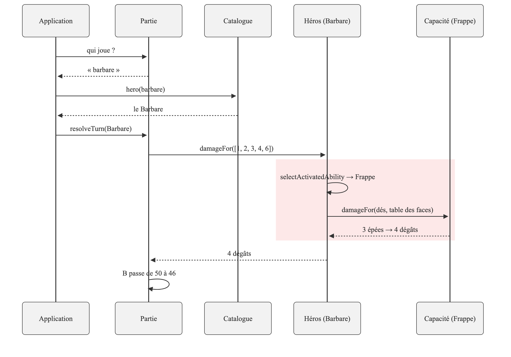

**Agojie** est l’automatisation de **Dice Throne**, un jeu de société de combat au tour par tour qui se joue avec des dés. Dans l’épisode précédent, les deux premières tranches avaient posé un squelette de partie et une machine à jets. Les tours alternaient, les dés tombaient, et personne n’attaquait encore.

Cet épisode couvre les trois tranches suivantes, écrites entre le 14 et le 18 juillet. À leur issue, une partie se joue de bout en bout : les dés désignent une capacité, la capacité inflige ses dégâts, le défenseur se soigne. La dernière des trois a aussi déplacé une règle du modèle. Ce n’est ni un test ni une relecture qui l’a montré. C’est une fiche de jeu.

## Les dés désignent une capacité

Chaque héros possède ses propres dés, et chaque face porte un symbole. Ses capacités offensives s’activent sur une combinaison de ces symboles. Prenons le résultat [1, 2, 3, 4, 6]. Pour le Barbare, les faces 1, 2 et 3 portent une épée : trois épées, <u>Frappe</u> est activée. Pour la Pyromancienne, ces mêmes faces portent une flamme, et c’est <u>Boule de Feu</u> qui s’active. Un même jet, deux héros, deux capacités.

Ce scénario vérifie que la sélection lit la donnée du héros, et qu’aucune règle propre au Barbare n’est écrite en dur dans le moteur. Voici le héros :


namespace App\Combat\Domain\Hero;

final readonly class Hero
{
    private function __construct(
        private FaceMapping $faceMapping,
        private array $abilities,
    ) {}

    public static function of(FaceMapping $faceMapping, array $abilities): self
    {
        return new self($faceMapping, $abilities);
    }

    public function selectActivatedAbility(DiceOutcome $outcome): ?Ability
    {
        foreach ($this->abilities as $ability) {
            if ($ability->matches($outcome, $this->faceMapping)) {
                return $ability;
            }
        }

        return null;
    }
}


Rien dans cette classe ne dit « Barbare ». Le héros reçoit la table qui associe chaque face à son symbole, puis la liste de ses capacités, et il parcourt cette liste. Le Barbare et la Pyromancienne sont deux objets de cette même classe, construits avec des données différentes. Ils vivent dans un catalogue en mémoire, derrière le **Port** ***HeroCatalog***. Voici le Barbare tel que ce catalogue le déclare :


namespace App\Combat\Infrastructure\Hero;

final class InMemoryHeroCatalog implements HeroCatalog
{
    // …

    private function barbarian(): Hero
    {
        return Hero::of(
            FaceMapping::fromPairs([
                1 => 'épée', 2 => 'épée', 3 => 'épée',
                4 => 'cœur', 5 => 'cœur',
                6 => 'boum',
            ]),
            [Ability::of('Frappe', SymbolCount::of(3, 'épée'))],
        );
    }
}


La table des faces dit quel symbole porte chaque face du dé. La capacité dit son nom et sa combinaison : au moins trois épées. La Pyromancienne se déclare de la même façon, avec des flammes à la place des épées et <u>Boule de Feu</u> à la place de <u>Frappe</u>. Ajouter un héros, c’est écrire une méthode de ce genre, sans toucher au moteur.

Reste à voir comment une capacité reconnaît sa combinaison. Le héros lui pose la question avec ***matches***, et la capacité la transmet à sa combinaison :


namespace App\Combat\Domain\Hero;

final readonly class Ability
{
    private function __construct(
        private string $name,
        private SymbolCount $combination,
    ) {}

    public static function of(string $name, SymbolCount $combination): self
    {
        return new self($name, $combination);
    }

    public function name(): string
    {
        return $this->name;
    }

    public function matches(DiceOutcome $outcome, FaceMapping $mapping): bool
    {
        return $this->combination->isSatisfiedBy($outcome, $mapping);
    }
}



namespace App\Combat\Domain\Hero;

final readonly class SymbolCount
{
    // …

    public function isSatisfiedBy(DiceOutcome $outcome, FaceMapping $mapping): bool
    {
        return $mapping->countOf($this->symbol, $outcome) >= $this->required;
    }
}


Sur [1, 2, 3, 4, 6], la table des faces du Barbare compte les dés qui portent une épée : les faces 1, 2 et 3, soit trois. La combinaison de <u>Frappe</u> en demande au moins trois. 3 ≥ 3 : la capacité répond, et le héros la rend. C’est le « au moins » de ***>=*** qui fait qu’un jet à cinq épées active aussi <u>Frappe</u>.

Côté application, cette lecture passe par une **Query**. C’est le versant lecture de CQRS décrit par *Greg Young* : un message qui demande un état sans rien modifier, symétrique de la **Command**. Le message ne porte que l’identifiant de la partie. Tout le travail se fait dans l’objet qui le traite :


namespace App\Combat\Application\FindActivatedAbility;

#[AsMessageHandler(bus: 'query.bus', method: 'handle')]
final readonly class FindActivatedAbilityQueryHandler
{
    public function __construct(
        private BattleRepository $repository,
        private HeroCatalog $catalog,
    ) {}

    public function handle(FindActivatedAbilityQuery $query): ?ActivatedAbilityView
    {
        $battle = $this->repository->find(BattleId::fromString($query->battleId));
        $activeHeroId = $battle->heroIdOf($battle->activeSide());
        $hero = $this->catalog->hero($activeHeroId);
        $ability = $hero->selectActivatedAbility($battle->offensiveOutcome());

        if (null === $ability) {
            return null;
        }

        return new ActivatedAbilityView($ability->name());
    }
}


Suivons-le sur notre exemple. A joue le Barbare et vient d’obtenir [1, 2, 3, 4, 6]. La partie est chargée. Elle ne contient pas le Barbare, seulement son identifiant : à la question « qui joue ? », elle répond « barbare ». Le catalogue reçoit cet identifiant et rend le héros correspondant :


namespace App\Combat\Infrastructure\Hero;

final class InMemoryHeroCatalog implements HeroCatalog
{
    // …

    public function hero(HeroId $id): Hero
    {
        return match ($id->value) {
            'barbare' => $this->barbarian(),
            'pyromancienne' => $this->pyromancer(),
            default => throw new \RuntimeException(sprintf('Unknown hero "%s".', $id->value)),
        };
    }
}


Le héros reçoit alors le résultat des dés, conservé par la partie, et le confronte à ses capacités. Trois épées : il rend <u>Frappe</u>, et la **Query** répond par son nom. Si A avait obtenu [4, 4, 5, 5, 6], aucune capacité n’aurait répondu, et la **Query** aurait rendu une réponse vide.

Cette **Query** s’appelait d’abord ***SelectActivatedAbilityQuery***. Le jour même, la relecture l’a fait renommer en ***FindActivatedAbilityQuery***. Le type de retour, ***?ActivatedAbilityView***, en donne la raison : la réponse peut être vide, et la convention du projet réserve le préfixe ***Find*** aux lectures qui peuvent ne rien rendre. Le héros garde ***selectActivatedAbility***, le nom du geste dans le jeu.

C’est le mécanisme que l’ADR décrivait dans l’épisode précédent, ici pour la première fois en code. La partie désigne le héros par son identifiant, l’application va chercher sa définition dans le catalogue, et c’est le héros qui applique sa propre règle.

## L’attaque frappe enfin

La tranche suivante applique les dégâts de la capacité activée. Les critères d’acceptation reprennent le même jet :

- B est à 50 points de vie. A obtient [1, 2, 3, 4, 6], soit trois épées, et <u>Frappe</u> est activée. B passe à 46.
- B est à 50. A obtient [1, 2, 3, 1, 2], soit cinq épées. B passe à 42.
- B est à 4. A active <u>Frappe</u> à 4 dégâts. B tombe à zéro, la partie s’arrête, A est vainqueur.

Voici le trajet d’un tour sur le premier exemple, avant d’entrer dans le code. La zone colorée est ce que la partie ne voit jamais :

Les dégâts dépendent du nombre de symboles obtenus. Dans le catalogue, la déclaration de <u>Frappe</u> gagne sa table de dégâts :


namespace App\Combat\Infrastructure\Hero;

final class InMemoryHeroCatalog implements HeroCatalog
{
    // …

    private function barbarian(): Hero
    {
        return Hero::of(
            FaceMapping::fromPairs([
                1 => 'épée', 2 => 'épée', 3 => 'épée',
                4 => 'cœur', 5 => 'cœur',
                6 => 'boum',
            ]),
            [Ability::of('Frappe', SymbolCount::of(3, 'épée'), [3 => 4, 4 => 6, 5 => 8])],
        );
    }
}


Trois épées infligent 4 dégâts, quatre en infligent 6, cinq en infligent 8. ***Ability*** reçoit cette table dans un troisième champ, ***damageByCount***, et gagne la méthode qui la lit :


namespace App\Combat\Domain\Hero;

final readonly class Ability
{
    // …

    public function damageFor(DiceOutcome $outcome, FaceMapping $mapping): Damage
    {
        $symbolsRolled = $this->combination->countIn($outcome, $mapping);

        if (!isset($this->damageByCount[$symbolsRolled])) {
            throw new \LogicException(sprintf('Ability "%s" deals no damage for %d symbols.', $this->name, $symbolsRolled));
        }

        return Damage::fromValue($this->damageByCount[$symbolsRolled]);
    }
}


Reprenons [1, 2, 3, 4, 6]. La capacité compte ses épées dans le résultat, avec la table des faces du Barbare : les faces 1, 2 et 3 en portent une, les faces 4 et 6 non. Trois épées. Pour trois symboles, la table de dégâts rend 4 : <u>Frappe</u> inflige 4 dégâts, et B passe de 50 à 46. Avec [1, 2, 3, 1, 2], le compte monte à cinq, la table rend 8, et B passe à 42.

Avant de coder une tranche, j’écris son plan technique : le chemin qu’une action suit dans le code, objet par objet. Le code s’écrit ensuite par petits cycles, ceux du **Test-Driven Development** de *Kent Beck* : un test qui échoue, le code qui le fait passer, puis un nettoyage. Ici, le plan technique prévoyait que la partie enchaîne elle-même les deux étapes. Elle devait demander au héros sa capacité activée, puis à cette capacité ses dégâts. Au troisième cycle, ce chemin n’a pas tenu. Pour compter ses symboles, la capacité a besoin de la table des faces du héros. La partie aurait donc dû aller chercher cette table dans le héros et la transmettre. L’état de la partie se serait mis à manipuler la donnée de catalogue, exactement ce que l’ADR cherchait à éviter.

C’est donc le héros qui compose les deux étapes :


namespace App\Combat\Domain\Hero;

final readonly class Hero
{
    // …

    public function damageFor(DiceOutcome $outcome): ?Damage
    {
        $activated = $this->selectActivatedAbility($outcome);

        if (null === $activated) {
            return null;
        }

        return $activated->damageFor($outcome, $this->faceMapping);
    }
}


La partie ne reçoit que le résultat : des dégâts, ou rien. Voici comment elle résout le tour :


namespace App\Combat\Domain\Battle;

final class Battle
{
    // …

    public function resolveTurn(Hero $activeHero): void
    {
        if ($this->isOver()) {
            throw BattleAlreadyOverException::cannotResolveTurn();
        }

        $damage = $activeHero->damageFor($this->offensiveOutcome());
        $this->offensiveRoll = null;

        $defendingSide = $this->opponentOf($this->activeSide);

        if (null !== $damage) {
            $this->strike($defendingSide, $damage);
        }

        if ($this->isOver()) {
            return;
        }

        $this->activeSide = $defendingSide;
    }

    private function strike(Side $defendingSide, Damage $damage): void
    {
        $defender = $this->combatantOf($defendingSide);
        $defender->takeDamage($damage);

        if ($defender->isDefeated()) {
            $this->winner = $this->activeSide;
        }
    }
}


L’application passe à la partie le héros actif, chargé depuis le catalogue comme dans la **Query** plus haut. La partie donne au héros le résultat des dés et reçoit 4 dégâts. Elle les applique à B, puis passe la main. Si B est à 4, il tombe à zéro, et A est déclaré vainqueur. Nulle part la partie ne voit une capacité, une table de faces ou une table de dégâts. L’écart a été consigné dans le plan technique, sous la version initiale, plutôt qu’effacé. Le plan corrigé et l’ADR disent désormais la même chose.

## Une fiche de jeu déplace une règle

La troisième tranche apporte la défense. Quand l’attaque active une capacité, le défenseur lance son jet défensif et se soigne. Pour le Barbare, c’est <u>Peau Dure</u>, qui soigne 2 points de vie par cœur obtenu. B est à 50. A inflige 6 dégâts, <u>Peau Dure</u> soigne 2. B finit à 46.

Il manquait une information pour écrire cette tranche. Le document qui décrit les héros marquait les jets défensifs comme provisoires, à confirmer sur fiche physique : combien de points de vie par symbole, et combien de dés. La tranche était pourtant déclarée prête. Le 17 juillet, j’ai lu les fiches. <u>Peau Dure</u> lance trois dés. <u>Armure en Fusion</u>, la défense de la Pyromancienne, en lance cinq.

Trois d’un côté, cinq de l’autre. Le nombre de dés est donc une donnée de la capacité, pas une constante du jeu. Or une règle du modèle affirmait le contraire depuis la machine à jets.

Cette règle est un **Invariant**. *Eric Evans* appelle ainsi une règle de cohérence qui doit rester vraie à chaque changement des données. Celle-ci disait qu’un résultat de dés compte exactement cinq faces, et elle vivait dans ***DiceOutcome***, l’objet qui représente le résultat d’un jet :


namespace App\Combat\Domain\Battle;

final readonly class DiceOutcome
{
    private const int FACE_COUNT = 5;

    public static function fromValues(array $values): self
    {
        if (self::FACE_COUNT !== count($values)) {
            throw new \InvalidArgumentException(sprintf(
                'A dice outcome must have exactly %d faces, got %d.',
                self::FACE_COUNT,
                count($values),
            ));
        }

        return new self(array_map(Face::fromValue(...), $values));
    }
}


Tant que le seul jet du jeu était l’offensive, rien n’était faux. Mais ***DiceOutcome*** ne représente pas un jet offensif, il représente un résultat de dés. La règle était attachée au mauvais concept. La spécification, elle, l’attachait déjà à la phase offensive : cinq dés, relance libre, trois jets au maximum. Avec cette règle en place, le Barbare ne pouvait pas se défendre. Son jet de <u>Peau Dure</u> donne trois faces, par exemple [4, 4, 5]. ***DiceOutcome::fromValues([4, 4, 5])*** compte trois valeurs au lieu de cinq, et lève « A dice outcome must have exactly 5 faces, got 3 ».

La règle a donc changé de domicile. ***DiceOutcome*** accepte désormais n’importe quel nombre de dés, et ne refuse plus que le résultat vide :


namespace App\Combat\Domain\Battle;

final readonly class DiceOutcome
{
    // …

    public static function fromValues(array $values): self
    {
        if ([] === $values) {
            throw new \InvalidArgumentException('A dice outcome must have at least one face.');
        }

        return new self(array_map(Face::fromValue(...), $values));
    }
}


Le cinq passe à ***OffensiveRoll***, l’objet qui porte la phase offensive et ses trois jets :


namespace App\Combat\Domain\Battle;

final readonly class OffensiveRoll
{
    public const int DICE_COUNT = 5;

    private const int MAX_ROLLS = 3;

    public static function initial(DiceOutcome $outcome): self
    {
        if (self::DICE_COUNT !== count($outcome->values())) {
            throw new \InvalidArgumentException(sprintf(
                'The offensive phase rolls exactly %d dice.',
                self::DICE_COUNT,
            ));
        }

        return new self($outcome, 1);
    }
}


Un détail confirme que la règle était mal placée. L’épisode précédent montrait l’objet qui traite la **Command** de lancer offensif. Il portait sa propre copie du cinq, parce qu’il devait savoir combien de dés demander au **Port** des dés :


namespace App\Combat\Application\RollOffensiveDice;

#[AsMessageHandler(bus: 'command.bus', method: 'handle')]
final readonly class RollOffensiveDiceCommandHandler
{
    private const int DICE_COUNT = 5;

    public function __construct(
        private BattleRepository $repository,
        private DiceRoller $diceRoller,
    ) {}

    public function handle(RollOffensiveDiceCommand $command): void
    {
        $battle = $this->repository->find(BattleId::fromString($command->battleId));
        $outcome = DiceOutcome::fromValues($this->diceRoller->roll(self::DICE_COUNT));
        $battle->rollOffense($outcome);
        $this->repository->save($battle);
    }
}


Cette copie disparaît. L’objet demande désormais le cinq à ***OffensiveRoll***, le seul endroit où il est écrit :


namespace App\Combat\Application\RollOffensiveDice;

#[AsMessageHandler(bus: 'command.bus', method: 'handle')]
final readonly class RollOffensiveDiceCommandHandler
{
    public function __construct(
        private BattleRepository $repository,
        private DiceRoller $diceRoller,
    ) {}

    public function handle(RollOffensiveDiceCommand $command): void
    {
        $battle = $this->repository->find(BattleId::fromString($command->battleId));
        $outcome = DiceOutcome::fromValues($this->diceRoller->roll(OffensiveRoll::DICE_COUNT));
        $battle->rollOffense($outcome);
        $this->repository->save($battle);
    }
}


Côté défense, le nombre de dés devient ce que montrait la fiche : une donnée. Dans le catalogue, le Barbare reçoit sa capacité défensive, après sa table des faces et sa capacité offensive. <u>Peau Dure</u> se déclare avec son symbole, son soin par symbole et son nombre de dés :


namespace App\Combat\Infrastructure\Hero;

final class InMemoryHeroCatalog implements HeroCatalog
{
    // …

    private function barbarian(): Hero
    {
        return Hero::of(
            FaceMapping::fromPairs([
                1 => 'épée', 2 => 'épée', 3 => 'épée',
                4 => 'cœur', 5 => 'cœur',
                6 => 'boum',
            ]),
            [Ability::of('Frappe', SymbolCount::of(3, 'épée'), [3 => 4, 4 => 6, 5 => 8])],
            DefensiveAbility::of('cœur', 2, 3),
        );
    }
}


Le cœur soigne 2 points de vie, et le jet se fait à trois dés. Ces trois valeurs deviennent les trois champs de la capacité défensive :


namespace App\Combat\Domain\Hero;

final readonly class DefensiveAbility
{
    private function __construct(
        private string $symbol,
        private int $healPerSymbol,
        private int $diceCount,
    ) {}

    public static function of(string $symbol, int $healPerSymbol, int $diceCount): self
    {
        return new self($symbol, $healPerSymbol, $diceCount);
    }

    public function diceCount(): int
    {
        return $this->diceCount;
    }

    public function resolve(DiceOutcome $outcome, FaceMapping $mapping): Heal
    {
        $symbolsRolled = $mapping->countOf($this->symbol, $outcome);

        return Heal::fromValue($symbolsRolled * $this->healPerSymbol);
    }
}


C’est ***diceCount*** que l’application consulte, par l’intermédiaire du héros, pour savoir combien de dés demander au **Port** des dés au moment de la défense. Le cinq reste une règle de la phase offensive. Le trois est une donnée de <u>Peau Dure</u>.

Suivons maintenant l’exemple de <u>Peau Dure</u>. A obtient [1, 2, 3, 1, 6] : quatre épées, <u>Frappe</u> inflige 6 dégâts. B lance ses trois dés de <u>Peau Dure</u> et obtient [4, 1, 2]. ***resolve*** compte les cœurs. Un seul 4, donc un seul cœur, multiplié par 2 : B se soigne de 2. La partie applique ensuite la perte nette :


namespace App\Combat\Domain\Battle;

final class Battle
{
    // …

    private function applyNetLoss(Side $defendingSide, Damage $damage, ?Heal $heal): void
    {
        $defender = $this->combatantOf($defendingSide);
        $defender->takeDamage($damage);

        if (null !== $heal) {
            $defender->heal($heal);
        }

        if ($defender->isDefeated()) {
            $this->winner = $this->activeSide;
        }
    }
}


B passe de 50 à 44 avec les dégâts, puis à 46 avec le soin.

Le soin exerce aussi la borne haute des points de vie, celle dont l’épisode précédent racontait la dette. Un héros à 49 qui se soigne de 2 ne doit pas finir à 51. C’est ***HitPoints*** qui le garde :


namespace App\Combat\Domain\Battle;

final readonly class HitPoints
{
    // …

    public function heal(Heal $heal): self
    {
        return new self(min(self::MAX, $this->value + $heal->value));
    }
}


49 plus 2 donnent 51, et ***min*** ramène le résultat à 50.

## Ce que ces trois tranches ont produit

Une partie se joue maintenant de bout en bout. Les dés désignent une capacité, l’attaque inflige ses dégâts, le défenseur se soigne, et celui qui tombe perd. Le héros a tenu sa place hors de la partie deux fois : quand les dés ont désigné sa capacité, et quand il a composé lui-même ses dégâts. Et une fiche de jeu a sorti le cinq de ***DiceOutcome*** pour le confier à la phase offensive.

Dans le prochain épisode, la défense ne se contente plus de soigner. <u>Armure en Fusion</u> renvoie des dégâts à l’attaquant, et une partie peut alors se terminer sur la chute de celui qui attaquait. Il faudra revoir ce que veut dire « gagner ».

N’hésitez pas à commenter cet article, que ce soit sur la modélisation ou sur la façon de raconter le projet.

À très bientôt pour un nouvel épisode.
